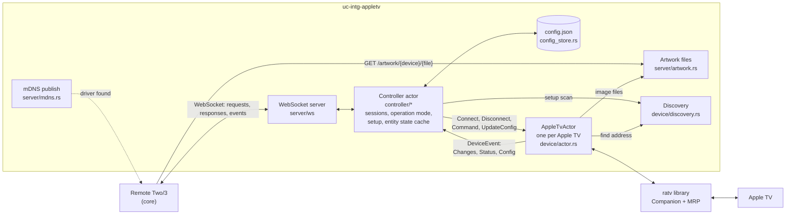
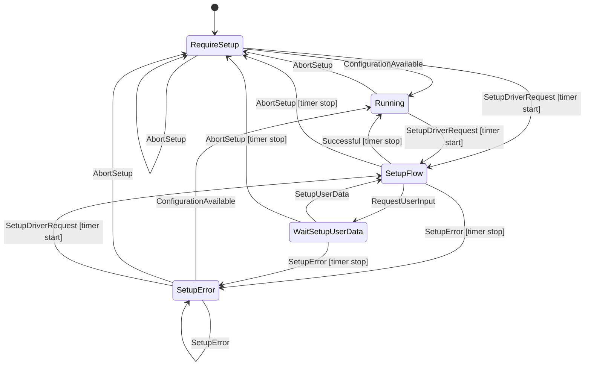
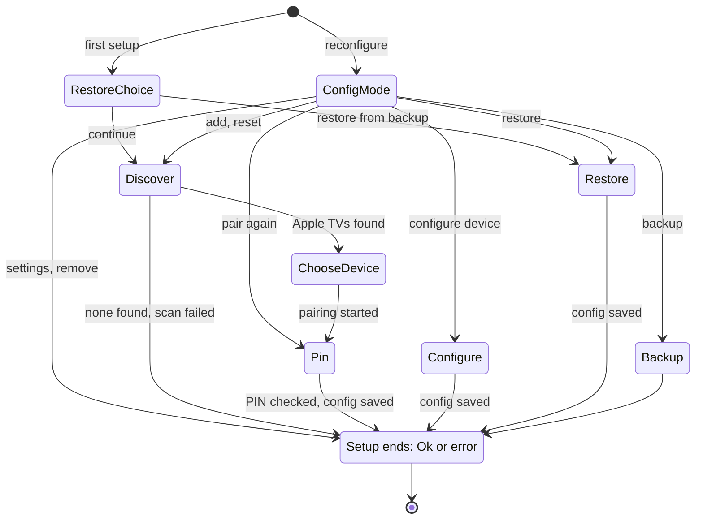
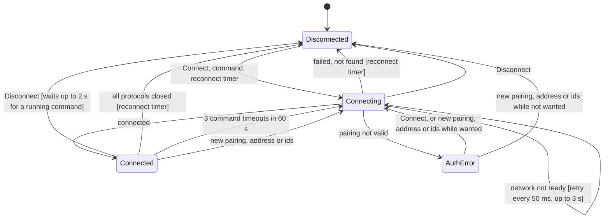
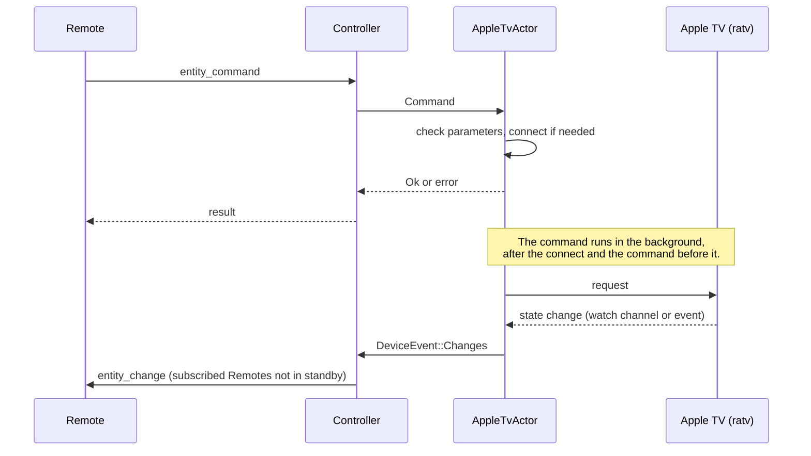

# Architecture

How the driver works. The diagrams show the main paths only. The code is the reference.

## Components

- The controller connects a device when an awake Remote uses one of its entities. It
  disconnects the device when no awake Remote uses it.
- A command also starts a connect. That connection stays until a Remote goes to standby or
  leaves.
- Device actors push changed attributes. The controller compares them with its cache and sends
  `entity_change` events to the Remotes that subscribed to the entity and are not in standby.

## Operation mode

The `operation_mode` state machine in `src/controller/mod.rs` (`rust_fsm`). Labels on the arrows
are the inputs. `[timer start]` and `[timer stop]` are the `SetupFlowTimer` and
`CancelSetupFlowTimer` outputs.

After an abort or a failed setup, the controller sends `ConfigurationAvailable` again when
devices are configured, so the mode goes back to `Running`. When the setup timer ends, the setup
ends with `SetupError`.

## Setup pages

`SetupState` in `src/controller/handler/setup.rs` is the page that the setup waits for. Input
that is not valid shows the same page again with an error.

- `Pin` is shown only when pairing could start. A pairing error ends the setup with an error.
- "Pair again" first scans for the configured device. If it is not found, the setup ends with
  an error.
- Every page that changes devices writes `config.json` first. If the write fails, nothing
  changes and the setup ends with an error.
- A first setup through discovery and `reset` replace all devices, but only when an Apple TV
  is paired. Restore always replaces all devices.

## Device connection

`DeviceStatus` in `src/device/mod.rs`, changed by `AppleTvActor` in `src/device/actor.rs`.

- Reconnect timer: 2 s times the number of tries since the last `Connect` or the last
  connection that stayed up for 60 s, at most 30 s. It runs only while the device is wanted.
- `Connected` can have only one protocol open. The actor tries to connect the missing protocol
  again and keeps the status.
- With the MRP join, Companion connects first and the status becomes `Connected`. MRP connects
  next. Commands wait for MRP for at most 0.5 s. Siri over MRP waits for the end of the join.
- After a requested `Disconnect`, the entities keep their state. After a lost connection, they
  become unavailable.
- `AuthError` stays after a `Disconnect`. There is no reconnect until the next `Connect`.
- While one device is in `AuthError`, the driver device state is `ERROR`.

## Entity command

- The result tells only that the command was accepted. Errors after the result are only logged.
- Voice commands answer through the controller with `DeviceEvent::Accepted`, so the result comes
  before the assistant events.
